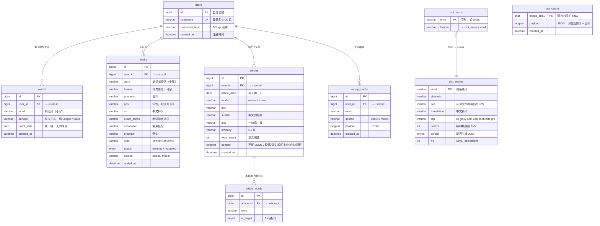

# 数据库设计（ER 图）

9 张表，全部 `utf8mb4` / InnoDB。建表语句见 [`../sql/init.sql`](../sql/init.sql)。

## 关系图

> GitHub 会直接渲染下面的 Mermaid；本地用 VS Code（装 Markdown Preview Mermaid 插件）或 Typora 也能看。

## 表清单

| # | 表 | 作用 | 关键约束 |
|---|---|---|---|
| 1 | `users` | 用户 | `uk_users_username` 唯一 |
| 2 | `words` | 每天导入的作业词 | `uk_words_user_date_word (user_id, batch_date, word)` 同一天同一个词只留一条 |
| 3 | `marks` | 生词本（阅读时收藏） | `uk_marks_user_word (user_id, word)` 收藏过的词再收藏是更新，不是新增 |
| 4 | `articles` | 生成的文章 | `uk_articles_user_date_mode (user_id, article_date, mode)` 一天一个模式只能有一篇 |
| 5 | `article_words` | 文章用了哪些词 | 外键级联删除 |
| 6 | `dict_entries` | 本地词典词条（21,339 条） | 主键就是 `word`；`translation` 建了全文索引 |
| 7 | `dict_forms` | 词形 → 原形（27,278 条） | 主键 `form`，查 `takes` 时先查这张表 |
| 8 | `lookup_cache` | 模型查过的词 | `uk_lookup_user_word`，避免同一个词重复花钱 |
| 9 | `ocr_cache` | 同一张图不重复识别 | 主键是图片内容的 sha1 |

## 几个设计取舍

**为什么 `articles.content` 存一整份 JSON，不拆成段落表、题目表？**

因为它的读写方式是「一次生成、整体展示」——没有任何场景需要单独查「第 3 段」。拆开要多 4 张表、多一堆 join，却换不来查询能力。真要统计题目正确率，再加一张独立的答题记录表更合适。

**为什么 `marks` 有 `word` 和 `lemma` 两列？**

`word` 是用户实际收藏的形态（可能是短语 `in terms of`），`lemma` 是词典原形。查词时用 `lemma` 命中词典，展示时用 `word` 保留原样。

**为什么 `dict_forms` 单独一张表？**

一个原形有多个变形（`take / takes / took / taken / taking`），塞进 `dict_entries` 的某一列会变成逗号分隔字符串，没法建索引。单独一张表，主键就是 `form`，查一个词最多两次点查：先 `dict_forms` 拿 `lemma`，再 `dict_entries` 拿释义。

**为什么 `ocr_cache` 的主键是 sha1？**

同一张截图经常被重复上传（手滑点两次、换浏览器再传一次）。用图片内容的 sha1 做键，命中就直接返回上次的识别结果 —— 离线引擎省几秒，将来换回百度云则是省钱。

**为什么 `words` 要存 `surface`？**

识别出来是 `Ledger`、`takes`，规范形要转成 `ledger`、`take` 才好查词典和查重。但界面上还是应该显示用户原本看到的形态，所以两个都留着。
