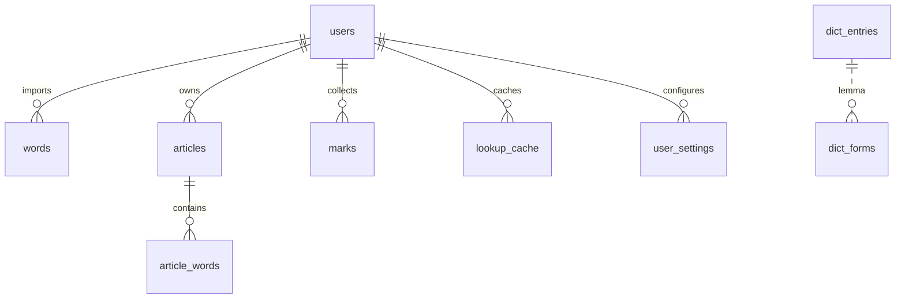

# 数据库设计

生产存储 MySQL 8.0，10 张表；体验模式 H2 文件库（MySQL 兼容模式），相同的业务 Mapper，单独的 schema-demo.sql 不含 MySQL FULLTEXT 索引。两种存储均经过实际集成测试，不能据此推断全部数据库行为完全相同。

| 表 | 关键键与用途 |
|---|---|
| users | id；username 唯一；BCrypt password_hash |
| words | user_id/date/word 唯一；按用户日期索引 |
| marks | user_id/word 唯一；learning/mastered；用户外键 |
| articles | user_id/article_date/mode 唯一；content 保存完整文章 JSON |
| article_words | article_id 外键级联删除；只记录真实命中目标词 |
| dict_entries | word 主键；公共词典，不含个人数据 |
| dict_forms | form 主键、lemma 索引；来源数据可能存在双向映射，精确词条优先 |
| lookup_cache | user_id/word 唯一，模型查词 JSON |
| ocr_cache | image_sha1 主键；公共图片识别结果，模拟结果不缓存 |
| user_settings | user_id/skey 主键；模型 Key 使用 AES-GCM |

init.sql 与 dict-data.sql 可重复执行，不删除现有数据，不是旧库结构迁移脚本。H2 启动也只用 CREATE TABLE IF NOT EXISTS。文章替换事务包含删除同用户同日期同模式旧文、插入新文、插入命中词；外部 HTTP 在事务外。插入命中词失败时旧文恢复，此行为已在两种真实数据库连接上验证。

备份个人数据必须同时备份数据库与 data/secret.key（体验模式为 data/demo/secret.key）。已有密钥文件损坏时启动报错而不覆盖。提交包不含作者数据与密钥。
