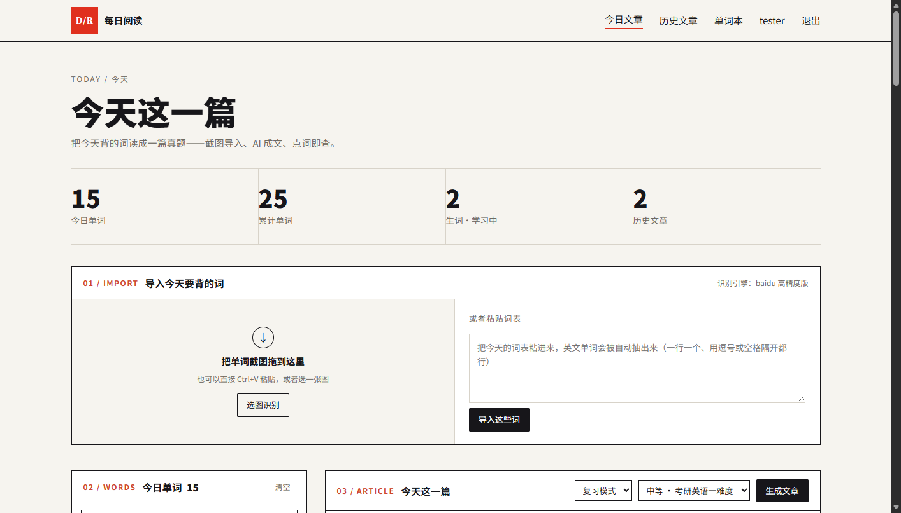
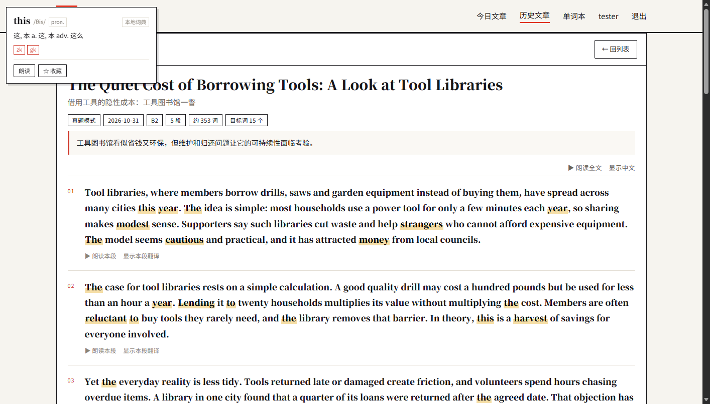
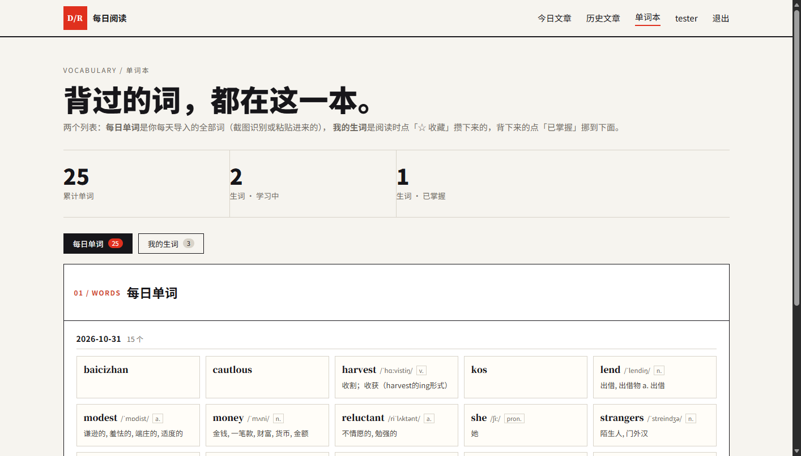
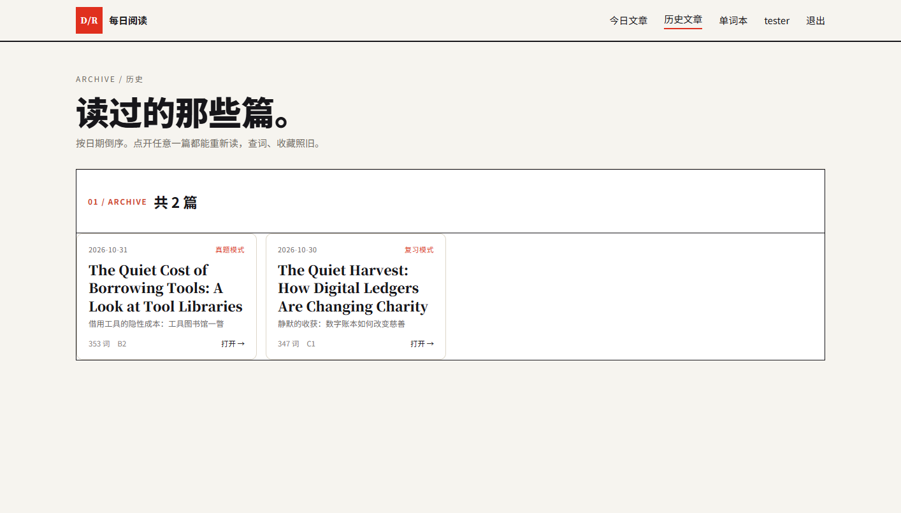

# 使用说明

这是我自己用的一个英语阅读小站：**把今天背的单词，变成一篇考研真题风格的英文文章**。
下面按“从打开到读完一篇”的顺序写一遍，每一步都配了截图。

---

## 0. 先启动

双击桌面的 **每日阅读** 图标，或者双击项目里的 `启动.cmd`。

它会自己做完两件事：先起 MySQL（3306），再起应用（8080），最后把浏览器打开到
<http://127.0.0.1:8080>。第一次启动会慢十几秒，是正常的。

如果不想用脚本，手工两步也行：

```bash
D:\MySQLServer\mysql-start.ps1
java -jar target\daily-reading-0.1.0.jar
```

> 关掉服务：结束 `java.exe` 进程，再跑 `D:\MySQLServer\stop-mysql.cmd`。

## 1. 注册 / 登录

第一次打开会跳到登录页，点「注册一个」建个账号；之后用同一个账号登录，词表和文章都跟着账号走。

## 2. 导入今天要背的词

这是整个流程的起点。首页最上面那块 **01 / IMPORT** 就是干这个的，跟下面的「今日单词」是分开的两块。



三种方式，挑一个就行：

- **拖图**：把单词截图直接拖进左边那块虚线区域（百词斩的单词列表、单词卡都行）
- **粘贴**：截完图直接 `Ctrl+V`，不用先存成文件
- **选图识别**：点「选图识别」从磁盘挑，可以一次选多张

识别出来后词会立刻出现在下面的「今日单词」里。不想截图也行，右边那个框可以**直接粘贴词表**
（一行一个、逗号或空格隔开都行），点「导入这些词」。

> 识别不准的词可以直接在面板里清掉重导。今日单词那里也有个搜索框，词多的时候用来找词。

## 3. 生成文章

在右下角 **03 / ARTICLE** 的头部选两样东西，再点「生成文章」：

- **模式**：复习模式（把词尽量都用上，句子偏短、好读）/ 真题模式（只挑一部分词，句长和结构按考研真题来）
- **难度**：简单 / 中等（考研英语一）/ 困难，主要控制句子长度和抽象程度

点下去到出文章大概 20–40 秒，中间会显示进度。生成完会同时存进「历史文章」，换日期也能再翻出来。

## 4. 读文章



- **点词查释义**：鼠标点任意单词，弹出音标、词性、中文释义
- **收藏**：浮层里点「☆ 收藏」，这个词进「我的生词」，正文里会有黄色标记
- **朗读**：右上「▶ 朗读全文」会一段一段念下去，念到哪段哪段高亮；每段左下角也有「▶ 朗读本段」，再点一次就停
- **中文**：右上「显示中文」一次显示全文翻译；下面每段还有「显示本段翻译」
- **做题**：文章末尾有 5 道选择，点选项才出答案解析和原文定位

## 5. 单词本



分两个列表：

- **每日单词**：按天分组，每张卡是词 + 音标 + 词性 + 词典释义，就是你导入过的全部词
- **我的生词**：读文章时收藏的，分「学习中 / 已掌握」两摞，背下来的点「已掌握」挪下去，随时能退回

## 6. 历史文章



按日期倒序列出所有生成过的文章，点任意一篇都能重新读、重新查词、重新收藏。

---

## 常见问题

**识别出来的词乱七八糟**
百词斩的「单词列表」截图效果最好。单词卡截图里例句太多时，会从例句里捞出 the / this 这种词，
把那几个删掉就行。

**点词没有释义**
本地词典收了 21,339 个考研 / 四六级 / 高频词，很生僻的词（或者人名）查不到是正常的，此时浮层只显示词本身。

**生成文章失败**
先看应用窗口的报错。最常见的两个：没配 `application-local.yml` 里的 DeepSeek Key；
或者 MySQL 没起来（`Connection refused`）。

**改了配置没生效**
`application-local.yml` 是打进 jar 里的，改完必须重新 `mvn package` 再启动，只重启进程不行。
