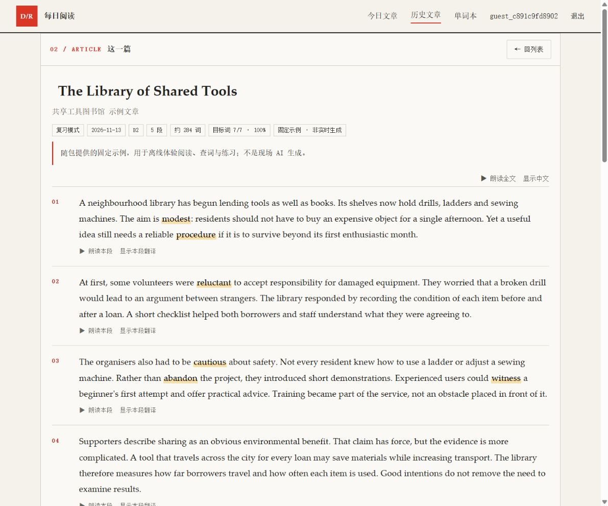

# 使用说明

## 无需安装的体验方式

完整解压后双击项目根目录「启动.cmd」，等待提示就绪并打开浏览器。无需 MySQL、Maven、Java 或 Key。点击登录页「直接体验示例阅读」进入；每次是新的独立临时账号。长期保存学习记录请注册账号，再点首页「载入示例文章」。示例不会覆盖已有当天复习文章。

## 阅读与练习

文章页明确标注固定示例。点「显示中文」查看译文，点高亮目标词查本地词典，点「☆ 收藏」加入生词本。点击理解题选项后显示解析和原文定位。朗读依赖浏览器系统语音，部分机器可能无可用英文声音。

## 导入与生成

首页「导入今天的单词」支持粘贴词表及 PNG/JPEG 截图；图片最多 10 MB、总像素不超过 2000 万。OCR 候选先核对再保存。离线引擎无法识别时模拟候选有提示，不代表真实识别结果。
新文章生成需要设置页填自己的 DeepSeek Key；调用可能产生费用。复习模式要求目标词至少八成，真题模式要求至少 min(15,N) 个；失败不会替换原文章。没有 Key 时使用固定示例完成阅读练习。

## 保存与停止

注册账号的数据保存在本地体验数据库中。点击「停止.cmd」停止本工程。移动数据前先停止，数据库与加密密钥应配套备份。项目副本不自动带入原 MySQL 数据。
MySQL 使用方式、端口与错误日志处理见根目录 README。

### 界面操作补充（2026-11-15）

登录和注册页可通过“显示／隐藏”检查密码；提交时按钮显示进度。阅读页可展开全文或单段译文，答题后同时显示文字反馈与解析。页面验证过期时选择“重新打开页面”，重新检查输入后再提交；系统不会自动重复模型调用。深浅主题继续通过“设置 → 外观”切换。示例始终标注为固定示例。
