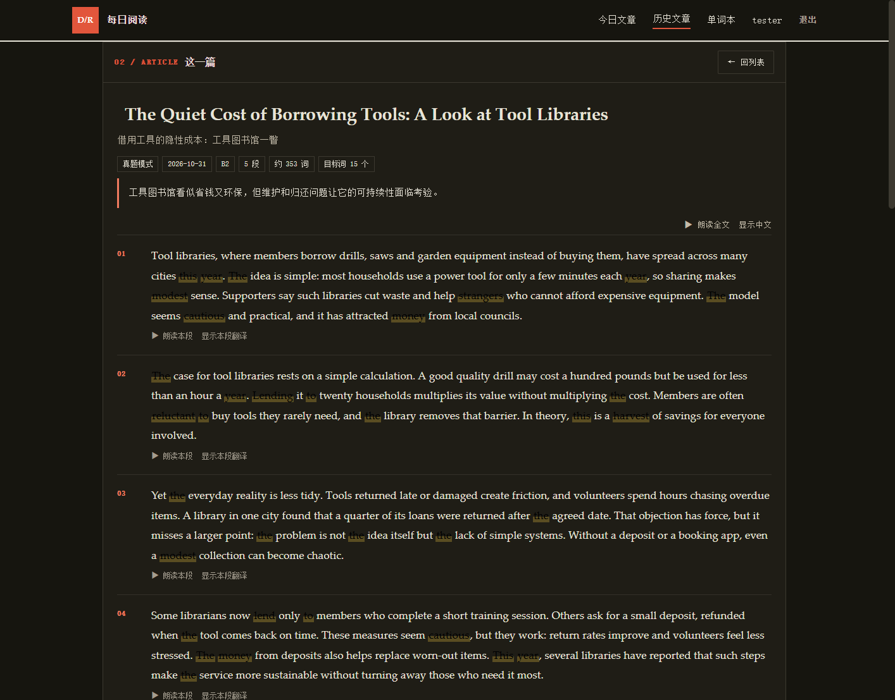
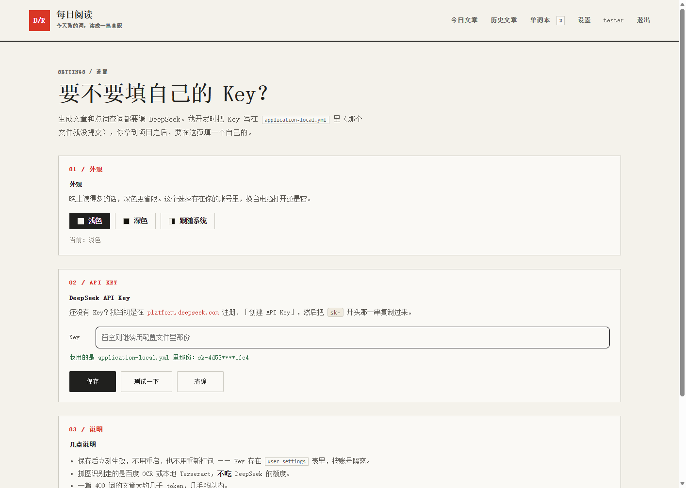
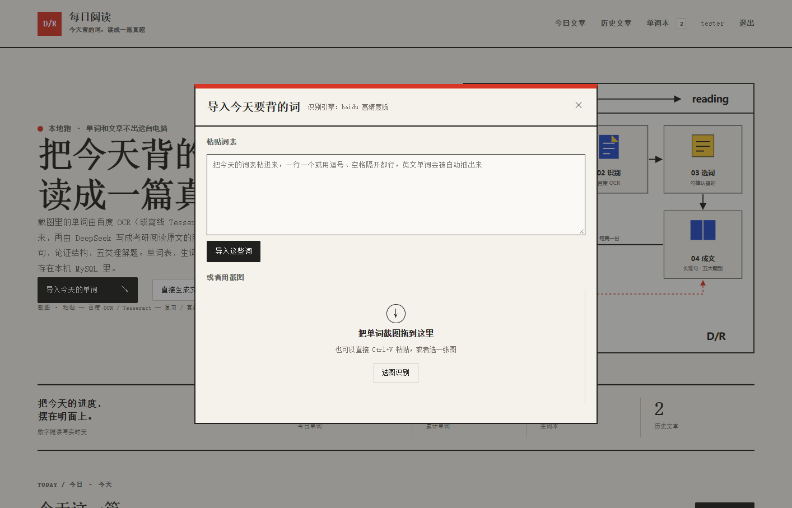
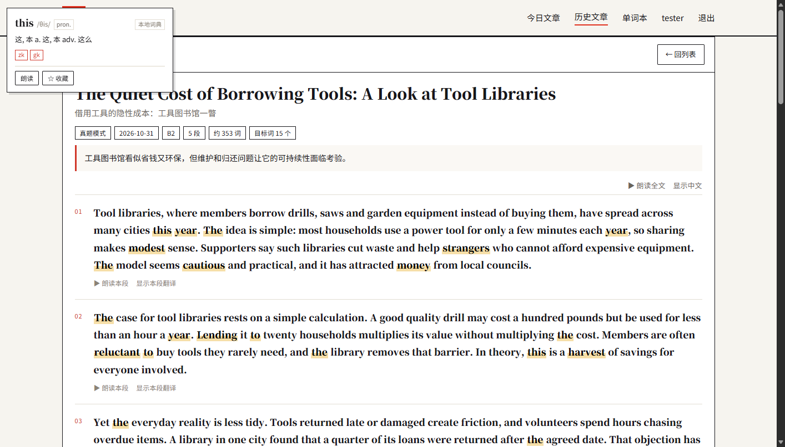
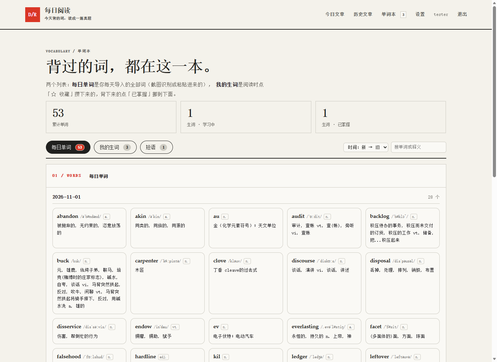
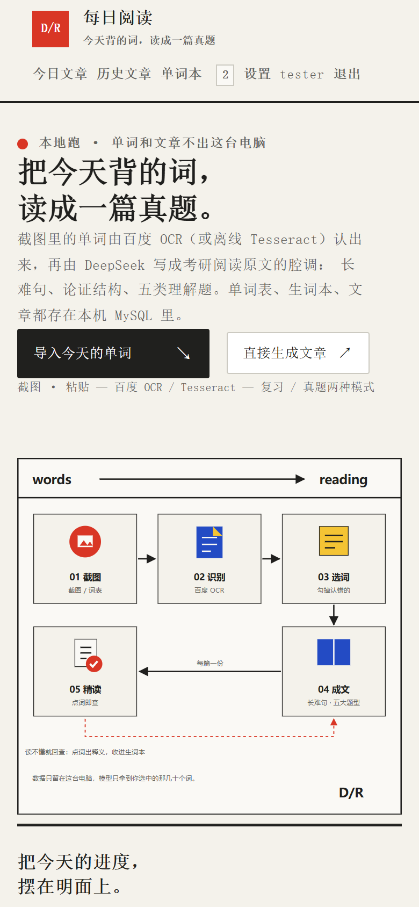
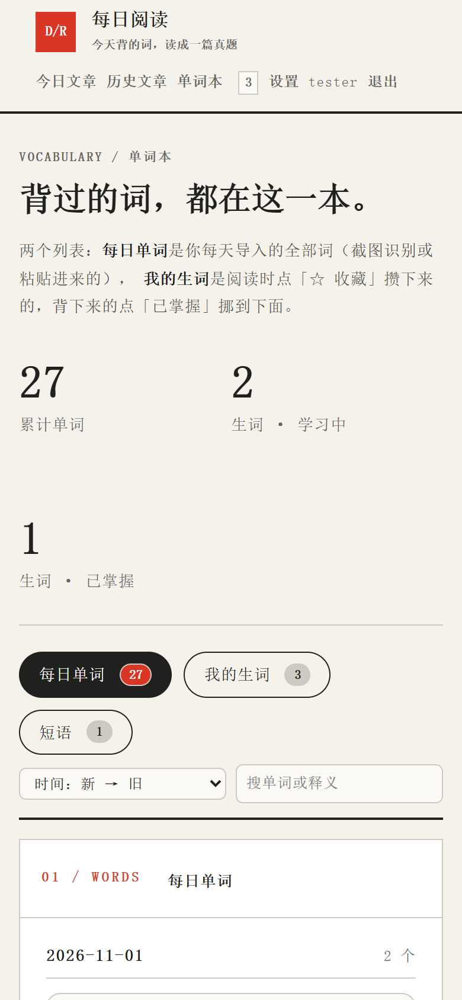
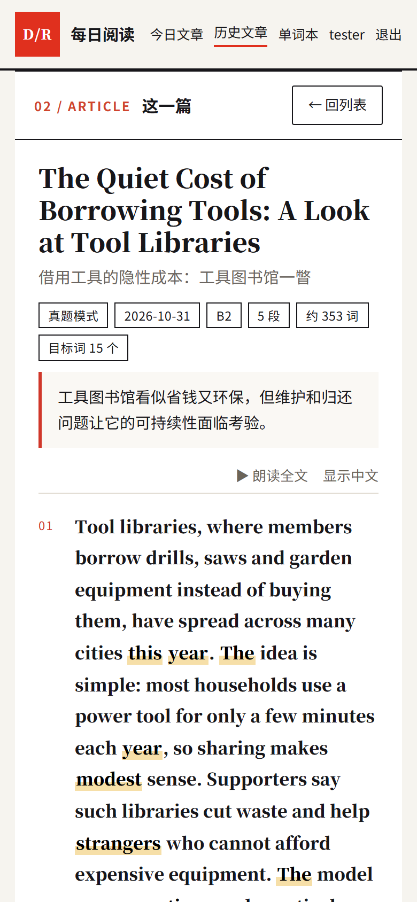

# 使用说明

这是我自己用的一个英语阅读小站：**把今天背的单词，变成一篇考研真题风格的英文文章**。
下面按“从打开到读完一篇”的顺序写一遍，每一步都配了截图。

---

## 0. 先启动

双击桌面的 **每日阅读** 图标，或者双击项目里的 `启动.cmd`。

它会自己做完两件事：先起 MySQL（3306），再起应用（8080），最后把浏览器打开到
<http://127.0.0.1:8080>。第一次启动会慢十几秒，是正常的。

如果不想用脚本，手工两步也行：

```bash
D:\MySQLServer\mysql-start.ps1
java -jar target\daily-reading-0.1.0.jar
```

> 关掉服务：结束 `java.exe` 进程，再跑 `D:\MySQLServer\stop-mysql.cmd`。

## 1. 注册 / 登录

第一次打开会跳到登录页，点「注册一个」建个账号；之后用同一个账号登录，词表和文章都跟着账号走。

## 1.2 换外观：浅色 / 深色 / 跟随系统

设置页最上面是「外观」，三个按钮点一下就切（选中的那个变成实心）：

- **浅色**：默认的米白纸底，白天看着舒服
- **深色**：夜里读不刺眼，正文换成浅灰而不是纯白，避免在深底上"发光"
- **跟随系统**：系统开了深色它就跟着变，系统切回来它也跟着切

选择存在你的账号里（`user_settings` 表的 `ui.theme`），所以换台电脑登录同一个账号还是这个外观。
深色下的阅读页长这样：




## 1.5 要不要填自己的 Key？

先别急着去申请 —— 打开「设置」，输入框下面那行小字会直接告诉你现在走的是哪一份 Key。

| 你的情况 | 要不要填 | 为什么 |
| --- | --- | --- |
| 只在自己电脑上用 | **不用** | 程序会先读 `application-local.yml` 里那份（我留的那份不提交，仓库里只有空模板） |
| 把项目发给别人 / 交作业 | **对方要自己填** | 我的 Key 只在这台机器上，不会跟着仓库走 |
| 老师在自己电脑上检查 | **老师要自己填**，或者用我的电脑演示 | 同上；我不建议把 Key 一起交上去 |

那行字是绿色、写着「我用的是 application-local.yml 里那份」，就说明配置文件里已经有 Key 了，你直接往下走；写「已保存你自己的 Key」说明你填过自己的，走的是你那份。

真需要填的时候：把 DeepSeek 的 `sk-` 开头的 Key 粘进输入框点保存，再点「测试一下」，几秒内回「能用，往返 XXX ms」就配好了。Key 存在库里是加密的（`enc:v1:` 开头），不会以明文躺在 `mysqldump` 里。填完立刻生效，不用重启、不用重新打包。没有 Key 就点页面里的 `platform.deepseek.com` 去申请。



只背单词不生成文章的话，这一步可以跳过——查词优先用内置的 2 万多词词典，不花钱。
## 2. 导入今天要背的词

这是整个流程的起点。点首页大标题下面那个 **「导入今天的单词」**，会弹出一个窗口，粘贴和截图都在里面，
不用再往下找面板。



窗口里两种方式，挑一个就行：

- **粘贴词表**：把今天的词表粘进上面的框，一行一个、逗号或空格隔开都行，点「导入这些词」
- **截图识别**：把百词斩的单词列表 / 单词卡截图拖进虚线区，或者直接 `Ctrl+V`，或者点「选图识别」从磁盘挑（可多选）

识别出来的词会立刻出现在下面的「今日单词」里，窗口可以关掉也可以留着继续加。

> 识别时会自动去掉看着不像词的碎片（`bl`、`kb` 这种被截断的），弹出的提示里会写去掉了几个。
> 打开「单词本」时也会自动扫一遍：缺释义的词交给模型补，模型判定不是词的直接删掉，
> 所以不会出现只有词头、没有释义的空卡（每轮最多 40 个，最多自动跑 3 轮）。
> 保存之后还会自动给词典里没有的词补中文释义；补的时候如果模型也判定它不是一个词，会顺手删掉，
> 所以单词本里不会留下只有词头、没有释义的空卡。
>
> 识别不准的词点「今日单词」右上角的「清空」重来。词多的时候，面板顶上那个搜索框用来快速找词。

## 3. 生成文章

在右侧 **03 / ARTICLE** 的头部选两样东西，再点「生成文章」：

- **模式**：复习模式（把词尽量都用上，句子偏短、好读）/ 真题模式（只挑一部分词，句长和结构按考研真题来）
- **难度**：简单 / 中等（考研英语一）/ 困难，主要控制句子长度和抽象程度

点下去到出文章大概 20–40 秒，中间会显示进度。生成完会同时存进「历史文章」，换日期也能再翻出来。

## 4. 读文章



- **点词查释义**：鼠标点任意单词，弹出音标、词性、中文释义
- **收藏**：浮层里点「☆ 收藏」，这个词进「我的生词」，正文里会有黄色标记
- **朗读**：右上「▶ 朗读全文」会一段一段念下去，念到哪段哪段高亮；每段左下角也有「▶ 朗读本段」，再点一次就停
- **中文**：右上「显示中文」一次显示全文翻译；下面每段还有「显示本段翻译」
- **做题**：文章末尾有 5 道选择，点选项才出答案解析和原文定位

## 5. 单词本



分两个列表：

- **每日单词**：按天分组，每张卡是词 + 音标 + 词性 + 词典释义，就是你导入过的全部词
- **我的生词**：读文章时收藏的。标题右边有「学习中 / 已掌握」两个按钮，点哪个就看哪一摞；
  两个按钮各自记着自己的排序方式（比如「学习中」按时间新→旧、「已掌握」按字母 A→Z），
  切来切去不会互相覆盖。背下来的词点「已掌握」挪到另一摞，随时能退回

## 6. 历史文章


按日期倒序列出所有生成过的文章，点任意一篇都能重新读、重新查词、重新收藏。

---

## 常见问题

**识别出来的词乱七八糟**
百词斩的「单词列表」截图效果最好。单词卡截图里例句太多时，会从例句里捞出 the / this 这种词，
把那几个删掉就行。

**点词没有释义**
本地词典收了 21,339 个考研 / 四六级 / 高频词，很生僻的词（或者人名）查不到是正常的，此时浮层只显示词本身。

**生成文章失败**
先看应用窗口的报错。最常见的两个：没配 `application-local.yml` 里的 DeepSeek Key；
或者 MySQL 没起来（`Connection refused`）。

**改了配置没生效**
`application-local.yml` 是打进 jar 里的，改完必须重新 `mvn package` 再启动，只重启进程不行。

## 7. 手机上能不能用

能。页面在 ≤720px 会切到窄屏版式：导航收成一行、统计从三列变两列、单词卡从多列变单列、阅读页正文 16px。

| 首页 | 单词本 | 阅读页 |
|---|---|---|
|  |  |  |

截图按 iPhone 尺寸（390×844，2 倍图）截的。